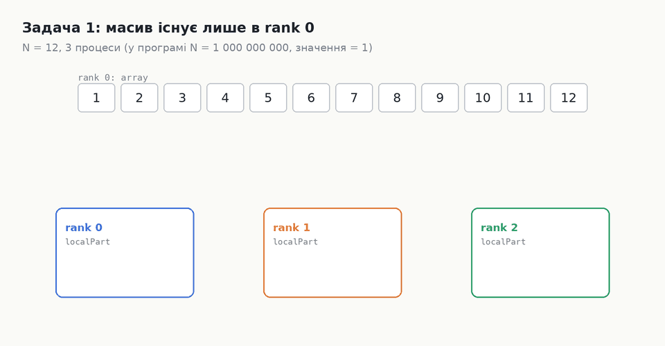
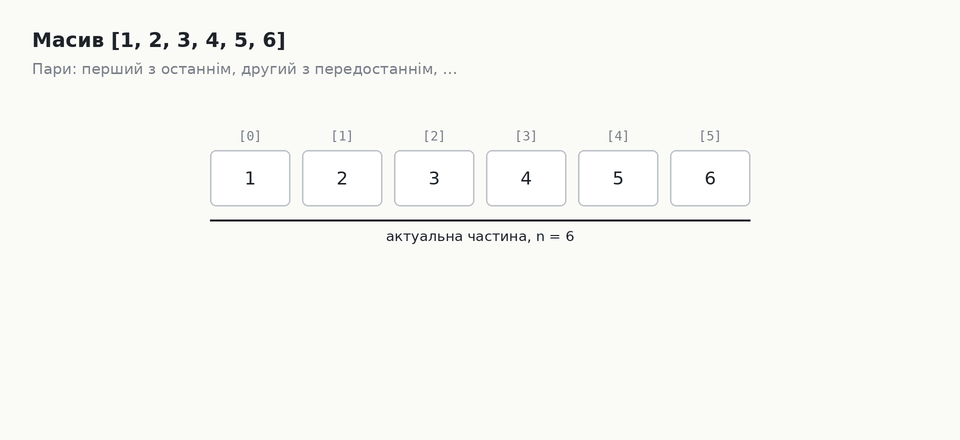
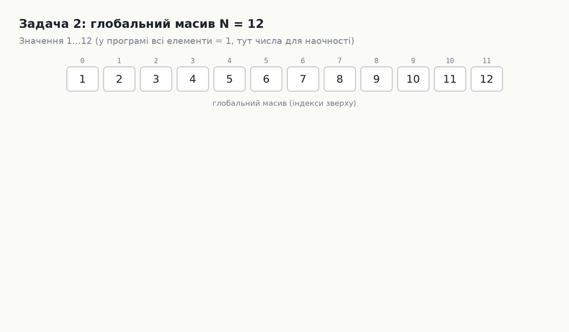
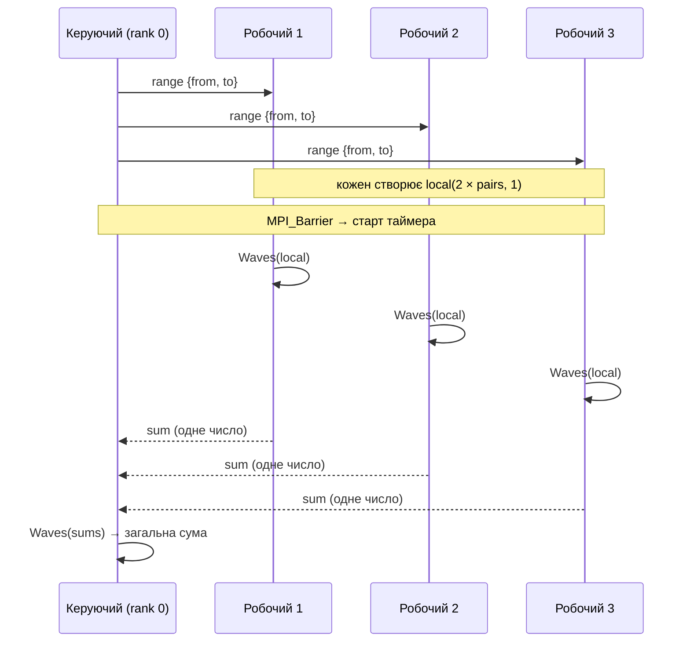

# MPI: паралельна сума елементів масиву

Дві програми на C++ з Open MPI, які рахують суму масиву з 1 000 000 000 елементів на кластері з трьох віртуальних машин.

| Файл | Задача | Головна ідея |
| --- | --- | --- |
| [`sum_mpi.cpp`](sum_mpi.cpp) | 1. Сума масиву | `MPI_Scatterv` роздає частини, кожен процес рахує свою, `MPI_Reduce` складає |
| [`sum_simple_mpi.cpp`](sum_simple_mpi.cpp) | 2. Попарна сума хвилями | Керуючий роздає індекси, робочі рахують хвилями на дзеркальних частинах |

## Зміст

- [Середовище: кластер на Multipass](#середовище-кластер-на-multipass)
- [Задача 1. Сума масиву через MPI_Scatterv](#задача-1-сума-масиву-через-mpi_scatterv)
- [Задача 2. Попарна сума хвилями](#задача-2-попарна-сума-хвилями)
- [Типові проблеми](#типові-проблеми)

---

## Середовище: кластер на Multipass

Кластер складається з трьох VM Ubuntu: `manager`, `worker1`, `worker2`. Скрипт `setup_mpi.py` налаштовує їх:

- прописує імена вузлів у `/etc/hosts`;
- налаштовує SSH без пароля між усіма вузлами;
- створює спільну NFS-папку `~/cloud` (сервер на `manager`), яку бачать усі вузли;
- створює файл `~/cloud/mpi_hosts` зі списком вузлів і кількістю слотів (`slots=4`).

**Після кожного перезапуску VM** IP-адреси змінюються, тож спочатку оновлюємо налаштування (у PowerShell):

```powershell
multipass list
python3 setup_mpi.py 3 --cpu 4 --ram 4096 --manager-ram 14336
multipass transfer sum_mpi.cpp manager:/home/ubuntu/cloud/
multipass transfer sum_simple_mpi.cpp manager:/home/ubuntu/cloud/
multipass shell manager
```

Компіляція і запуск (у `manager`):

```bash
cd ~/cloud
mpic++ -O2 -std=c++17 sum_mpi.cpp -o sum_mpi && mpirun --hostfile mpi_hosts -np 12 --use-hwthread-cpus ./sum_mpi
mpic++ -O2 -std=c++17 sum_simple_mpi.cpp -o sum_simple_mpi && mpirun --hostfile mpi_hosts -np 12 --use-hwthread-cpus ./sum_simple_mpi
```

| Параметр | Що означає |
| --- | --- |
| `--hostfile mpi_hosts` | На яких машинах запускати процеси |
| `-np 12` | Скільки процесів запустити (3 вузли × 4 слоти) |
| `--use-hwthread-cpus` | Рахувати потоки процесора як ядра. Hyper-V показує VM 4 CPU як 2 ядра × 2 потоки, без цього прапорця буде помилка `allocation-overload` |
| `&&` | `mpirun` запуститься, лише якщо компіляція пройшла успішно, інакше запустилась би стара програма |

---

## Задача 1. Сума масиву через MPI_Scatterv

Файл: [`sum_mpi.cpp`](sum_mpi.cpp)

### Ідея



Масив з мільярда одиниць існує тільки в процесі `rank 0`. Він ділить масив на частини і роздає кожному процесу його частину. Процеси одночасно рахують суми своїх частин, а `MPI_Reduce` складає ці часткові суми в `rank 0`.

### Як працює програма

1. **`MPI_Init`** запускає MPI. `MPI_Comm_rank` дає кожному процесу його номер (`rank`, від 0 до 11), `MPI_Comm_size` дає кількість процесів (`size`). Код у всіх процесів однаковий, а різну роботу вони роблять завдяки різним `rank`.
2. **Таблиця розподілу.** Кожен процес за функцією `SplitArray` рахує `counts` (скільки елементів отримає кожен процес) і `displs` (з якого індексу починається кожна частина). Таблиці однакові в усіх, тож пересилати їх не треба.
3. **Масив створюється лише в `rank 0`**: `array.assign(arrayLength, 1)`.
4. **`MPI_Scatterv`** роздає частини: `rank 0` відправляє кожному процесу його шматок, і кожен отримує свій у `localPart`.
5. **Обчислення між двома `MPI_Barrier`.** Кожен процес складає свою частину циклом.
6. **`MPI_Reduce(MPI_SUM)`** складає часткові суми в `rank 0`, і він друкує результат.

### `counts` і `displs` на прикладі

10 елементів, 4 процеси. Межі частини: `start = p·10/4`, `end = (p+1)·10/4` (ділення цілочисельне):

| `p` | start | end | `counts[p]` | `displs[p]` |
| --- | --- | --- | --- | --- |
| 0 | 0 | 2 | 2 | 0 |
| 1 | 2 | 5 | 3 | 2 |
| 2 | 5 | 7 | 2 | 5 |
| 3 | 7 | 10 | 3 | 7 |

Перевірка: сума `counts` дорівнює довжині масиву, а кожен `displs` = попередній `displs` + попередній `counts`.

### Параметри `MPI_Scatterv`

```cpp
MPI_Scatterv(array.data(), counts.data(), displs.data(), MPI_LONG_LONG,   // що відправляти (лише в rank 0)
             localPart.data(), counts[rank], MPI_LONG_LONG,               // куди отримати свою частину
             0, MPI_COMM_WORLD);                                          // хто розсилає, група процесів
```

| Операція | Що робить |
| --- | --- |
| `MPI_Bcast` | Один відправляє **однакові** дані всім |
| `MPI_Scatter` | Один роздає **рівні** частини |
| **`MPI_Scatterv`** | Один роздає частини **різного** розміру (мільярд не завжди ділиться націло) |
| `MPI_Gather` | Усі відправляють свої частини одному |
| `MPI_Reduce` | Усі відправляють числа одному, і вони одразу складаються |

### Чому два `MPI_Barrier`

```cpp
MPI_Barrier(MPI_COMM_WORLD);      // чекаємо, поки ВСІ отримали свої частини
double start = MPI_Wtime();
// ... сума своєї частини ...
MPI_Barrier(MPI_COMM_WORLD);      // чекаємо, поки порахує НАЙПОВІЛЬНІШИЙ
double mpiTime = (MPI_Wtime() - start) * 1000.0;
```

- **Без першого** таймер `rank 0` запустився б, поки інші ще отримують дані, і в час потрапило б пересилання.
- **Без другого** таймер зупинився б, коли закінчив `rank 0`, а не останній процес.

Тобто `Time` — це **чистий час обчислення**, без розсилки даних.

### Чому друкує лише `rank 0`

`MPI_Reduce` кладе результат тільки в `rank 0`. В інших процесах `mpiTotal` лишається `0`. Без `if (rank == 0)` ми побачили б 12 виводів: одну правильну суму і 11 рядків `Sum: 0` з помилкою.

### Пам'ять

Один `long long` займає 8 байтів, тож масив займає 8 ГБ, і весь він лежить у `rank 0` на `manager`.

| `-np` | `manager` (ranks 0–3) | кожен worker |
| --- | --- | --- |
| 12 | ≈10.7 ГБ → потрібно **14 ГБ** | ≈2.7 ГБ → потрібно **4 ГБ** |
| 8 | ≈12 ГБ | ≈4 ГБ (на межі) |
| 1, 2, 4 | ≈16 ГБ, **не вміщається** | — |

Для серії замірів з малою кількістю процесів зменшіть `arrayLength` до `100000000`.

### Результат

```
=== MPI ===
Processes: 12
Sum: 1000000000
Time: … ms
```

### Висновок

- Час обчислення зменшується з кількістю процесів, але не в 12 разів:
  - фізично всі VM працюють на одному ноутбуці з 8 ядрами;
  - кожна VM бачить 4 CPU як 2 ядра × 2 потоки;
  - сума упирається в швидкість пам'яті;
  - під навантаженням падає частота процесора.
- Розсилка частин масиву (`MPI_Scatterv`) займає значно більше часу, ніж саме додавання. Для такої простої операції, як сума, передача даних «з'їдає» виграш від паралельності.

---

## Задача 2. Попарна сума хвилями

Файл: [`sum_simple_mpi.cpp`](sum_simple_mpi.cpp)

### Умова (коротко)

Сума масиву з 1 000 000 000 елементів попарним додаванням:

- перший елемент з останнім, другий з передостаннім і так далі;
- результат зберігається в доданку з меншим індексом;
- дійшовши до середини, друга половина відкидається, і все починається спочатку;
- так триває, поки актуальна довжина не стане 1.

Потрібна фіксована кількість робочих, співрозмірна з кількістю ядер, і керуючий, який роздає індекси й синхронізує хвилі.

### Алгоритм хвиль



| Хвиля | `n` | Пари | Актуальна частина після хвилі |
| --- | --- | --- | --- |
| 1 | 6 | 1+6, 2+5, 3+4 | `[7, 7, 7]` |
| 2 | 3 | 7+7 (середній чекає) | `[14, 7]` |
| 3 | 2 | 14+7 | `[21]` |

### Функція `Waves`: алгоритм із задачі

```cpp
int Waves(std::vector<int>& arr)
{
    if (arr.empty())
    {
        return 0;
    }

    int n = static_cast<int>(arr.size());   // актуальна довжина
    while (n > 1)                           // одна ітерація = одна хвиля
    {
        int pairs = n / 2;
        for (int i = 0; i < pairs; i++)
        {
            int j = n - 1 - i;              // симетричний індекс з кінця
            arr[i] += arr[j];               // результат у менший індекс
        }
        n -= pairs;                         // відкидаємо другу половину: n = ⌈n/2⌉
    }
    return arr[0];
}
```

Ця функція використовується **двічі**: робочими на своїх частинах масиву і керуючим на масиві результатів робочих.

### Проблема: у процесів немає спільної пам'яті

На першій хвилі елемент `0` складається з елементом `999 999 999`. Пари лежать у різних кінцях масиву, а на кластері це різні машини. Якщо пересилати їх через керуючого, мережею піде ≈12 ГБ. Ми так пробували, і це зайняло **14 секунд**.

### Рішення: дзеркальний розподіл



Кожен робочий отримує **блок з початку масиву і дзеркальний блок з кінця**. Тоді пари першої хвилі лежать в одного робочого, і масив не потрібно пересилати.

На прикладі `N = 12`, 3 робочих:

| Робочий | `range` | `pairs` | `local` | Глобальні індекси |
| --- | --- | --- | --- | --- |
| 1 | {0, 2} | 2 | 4 елементи | 0, 1 і 10, 11 |
| 2 | {2, 4} | 2 | 4 елементи | 2, 3 і 8, 9 |
| 3 | {4, 6} | 2 | 4 елементи | 4, 5 і 6, 7 |

Перша локальна хвиля робочого 1 на `[a0, a1, a10, a11]` складає `a0 + a11` і `a1 + a10`. Це точно глобальні пари першої хвилі.

```cpp
int pairs = range[1] - range[0];          // скільки пар першої хвилі в мене
std::vector<int> local(2 * pairs, 1);     // кожна пара = 2 елементи, усі дорівнюють 1
```

### Як працює програма



1. **Керуючий (`rank 0`)** ділить пари першої хвилі `[0, N/2)` між робочими і відправляє кожному лише два числа: `{from, to}`.
2. **Робочий** сам створює свою частину: `2 × pairs` одиниць (блок з початку + дзеркальний блок з кінця).
3. **Після `MPI_Barrier`** вмикається таймер. Кожен робочий виконує `Waves(local)` і відправляє керуючому одне число, суму своєї частини.
4. **Керуючий** чекає результатів від усіх робочих (це точка синхронізації), складає їх у масив `sums` і виконує на ньому ту саму `Waves`. Потім друкує суму й час.

### Що йде мережею

| Напрямок | При `-np 12` |
| --- | --- |
| Керуючий → робочі: індекси `{from, to}` | 11 × 2 = 22 числа |
| Робочі → керуючий: результати | 11 чисел |
| **Разом** | **33 числа ≈ 132 байти** (проти ≈12 ГБ у версії з пересиланням) |

### Відповідність умові

| Умова (для потоків) | У MPI-версії | Чому |
| --- | --- | --- |
| Попарне додавання, результат у менший індекс, хвилі до довжини 1 | `Waves`: `j = n - 1 - i`, `arr[i] += arr[j]`, `n -= pairs` | Без змін |
| Фіксована кількість робочих потоків | Робочі **процеси**, кількість задає `-np` | У MPI одиниця паралельності — процес |
| Керуючий роздає вільним робочим індекси | Керуючий роздає кожному робочому рівну порцію індексів на початку | Порції однакові, тож робочі закінчують майже одночасно |
| Синхронізація між хвилями | Хвилі робочого йдуть послідовно в ньому самому. Керуючий чекає **всіх** результатів, а потім робить останні хвилі | Точка синхронізації — `MPI_Recv` від кожного робочого |

Перша хвиля збігається з глобальною один в один. Далі кожен робочий продовжує хвилі на своїй частині, а потім керуючий об'єднує результати хвилями. Правило кожного кроку те саме, і сума та сама, але конкретні пари після першої хвилі інші, ніж на одному спільному масиві. Це плата за те, щоб не пересилати дані мережею.

### Чому саме цей варіант

Ми спробували кілька підходів:

| Варіант | Що йде мережею | Результат |
| --- | --- | --- |
| Керуючий пересилає робочим елементи кожної пари | ≈12 ГБ через один процес | Правильно, але 14 156 мс |
| Спільна пам'ять MPI (`MPI_Win_allocate_shared`) | лише індекси | Швидко, але працює тільки в межах однієї машини |
| Гібрид: MPI між вузлами + потоки з семафорами всередині | кілька чисел | Швидко, але код складний для пояснення |
| **Дзеркальний розподіл, лише процеси (цей файл)** | **33 числа** | **Швидко і просто** |

### Пам'ять

Тип `int` (4 байти). Кожен робочий тримає ≈`N / кількість робочих` елементів: при 11 робочих це ≈91 млн чисел, тобто ≈360 МБ. Цілого масиву ніде немає, тож вистачить навіть 2 ГБ на VM.

### Результат

```
Elements: 1000000000, workers: 11 + controller
Sum: 1000000000 (correct)
Time: … ms
```

Мінімум 2 процеси (1 керуючий + 1 робочий). З `-np 1` програма виведе підказку.

---

## Типові проблеми

| Симптом | Причина | Що робити |
| --- | --- | --- |
| `ssh: connect to host worker1 ... No route to host` | Після перезапуску VM змінились IP | `python3 setup_mpi.py 3 --cpu 4 --ram 4096 --manager-ram 14336` |
| `setup_mpi.py` зависає на перевірці NFS | NFS змонтована за старим IP manager | Оновлена версія скрипта перемонтовує сама. Вручну: `multipass exec worker1 -- sudo umount -f -l /home/ubuntu/cloud`, потім `sudo mount /home/ubuntu/cloud` |
| `allocation-overload` | VM бачить 4 CPU як 2 ядра × 2 потоки | Додати `--use-hwthread-cpus` |
| `not enough slots available` | `-np` більше, ніж слотів у `mpi_hosts` | Зменшити `-np` або додати `--oversubscribe` |
| `exited on signal 9 (Killed)` | Не вистачило пам'яті | Збільшити RAM VM (`multipass set local.manager.memory=14G`) або зменшити масив |
| Вивід старої версії програми | Новий файл не скопійовано у VM або компіляція впала | `multipass transfer ...`, компілювати через `&&` |
| `error: 'x' was not declared` | Змінну прибрали, але вона ще використовується | Прибрати всі її використання |

## Файли

```
mpi_lab/
├── README.md
├── sum_mpi.cpp            # задача 1: MPI_Scatterv + MPI_Reduce
├── sum_simple_mpi.cpp     # задача 2: попарна сума хвилями, керуючий + робочі
└── img/
    ├── scatter.gif        # анімація задачі 1
    ├── waves.gif          # анімація алгоритму хвиль
    └── mirror.gif         # анімація дзеркального розподілу
```
